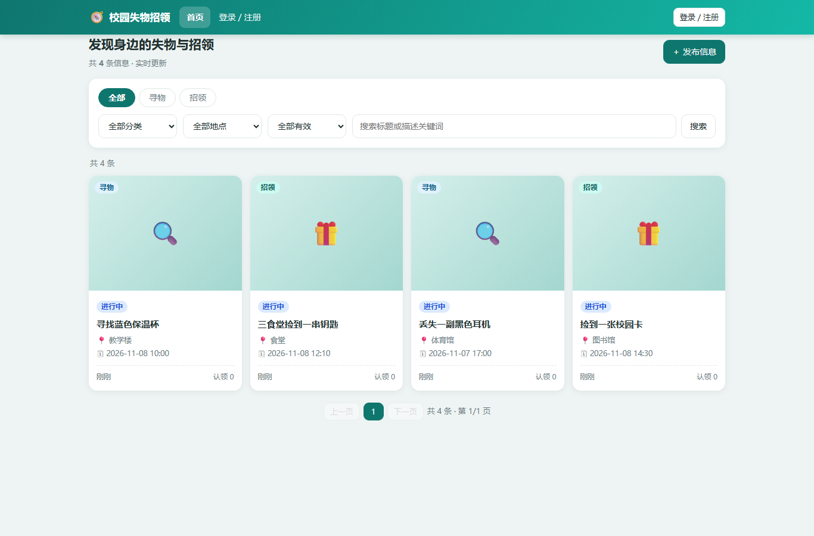
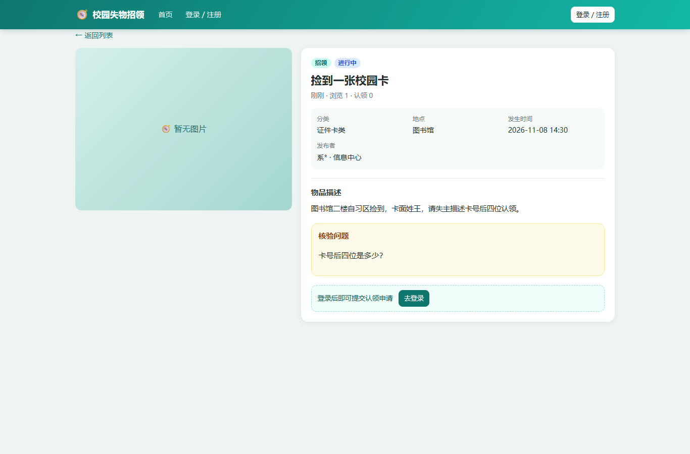

# 校园失物招领系统 · Campus Lost & Found

**零第三方依赖的校园失物招领平台**：C++20 后端（Win32 Winsock 自研 HTTP + SSE）+ 内嵌单页前端 + JSON 持久化。
用 Visual Studio 2022 打开解决方案直接 `F5` 即可运行，不需要 vcpkg、不需要 Node、不需要数据库。




---

## 为什么值得一看

| 特点 | 说明 |
|---|---|
| **真正的零依赖** | 只用 Windows 自带库（`ws2_32` / `bcrypt` / `iphlpapi`），克隆后无需任何包管理器步骤 |
| **单可执行文件交付** | 前端 HTML/CSS/JS 以 raw string 内嵌进 exe，改完编译即一个 `CampusLostFound.exe` |
| **完整业务闭环** | 不是 CRUD 演示：核验问题 → 认领审核 → 一次性取件码 → 线下核销 → 双向通知，含状态机与自动过期 |
| **自研 HTTP 服务** | HTTP/1.1 路由、multipart 上传、Cookie 会话、SSE 推送，约 2 万行 C++ 手写实现 |
| **安全不是事后补的** | PBKDF2-HMAC-SHA256、CSRF 头校验、上传 Magic Bytes 校验、越权逐资源鉴权、限流与审计日志 |

---

## 功能

**用户端**
- 注册（邀请码制）/ 登录 / 改密 / 注销，服务端会话 Cookie
- 列表浏览：类型、分类、地点、状态筛选 + 中文子串搜索 + 分页
- 发布寻物/招领：分类、地点、时间、核验问题、有效期 1~90 天
- 图片上传：每帖最多 3 张，JPG/PNG/WebP，单张 ≤5MB，Magic Bytes 校验
- 认领闭环：提交申请 → 发布者审核 → 6 位一次性取件码（24h）→ 线下核销 → 双方通知
- 通知中心（未读红点 / 全部已读 / 点击跳转）、举报违规
- 实时更新：SSE 推送新物品、认领状态、通知，多端同步

**管理后台**
- 统计看板、举报处理、邀请码管理、审计日志、物品下架（带原因并通知发布者）

**业务规则**
- 状态机：`open → claim_pending → claim_approved → completed`，另有 `expired` / `removed`
- 一物一认领（Store 层原子检查）
- 物品 30 天自动过期；认领 24h 未审核自动过期；取件码 24h 有效
- 姓名/学号脱敏展示，联系方式不公开

---

## 技术栈

| 层 | 选型 |
|---|---|
| 语言 | C++20（MSVC v143，`/utf-8`） |
| HTTP | 自研 HTTP/1.1，Winsock2，线程 per 连接 |
| 实时 | Server-Sent Events（`/api/stream`），浏览器 `EventSource` 自动重连 |
| 持久化 | JSON 全量快照 + 原子写（`db.json.tmp` → rename），图片落 `data/uploads` |
| 密码 | PBKDF2-HMAC-SHA256，60000 次迭代 + 16 字节随机盐，常量时间比较 |
| 前端 | 原生 HTML/CSS/JS，哈希路由，无 CDN、无外部资源 |
| 测试 | 进程内自测 71 项 + HTTP 冒烟测试 40 项（含明文凭据泄露、SSE 注销失效、状态机边界检查） |

---

## 快速开始

**前置**：Windows 10/11 x64 + Visual Studio 2022（勾选"使用 C++ 的桌面开发"工作负载）

1. 双击打开 `app/CampusLostFound.sln`
2. 选择 `Debug` + `x64`，按 `Ctrl+F5`
3. 浏览器访问 <http://127.0.0.1:8080>
4. 控制台会打印局域网访问地址；**首次启动还会打印一次随机管理员密码**（仅显示一次）
5. 用 admin + 该密码登录 → 修改密码 → 在「管理后台 → 邀请码」创建邀请码（完整码仅显示一次）→ 发给同学注册

| 项 | 值 |
|---|---|
| 管理员 | `admin` / **首次启动控制台随机密码（仅显示一次，登录后立即修改）** |
| 邀请码 | **不预置**；管理员后台创建，数据库只存哈希，列表只显示掩码，完整码仅创建时显示一次 |

命令行启动参数：

```text
CampusLostFound.exe [--port 8080] [--bind 0.0.0.0] [--data <目录>] [--selftest]
```

---

## 目录结构

```text
campus-lostfound/
├─ app/                          # 可编译工程（VS 解决方案）
│  ├─ CampusLostFound.sln
│  ├─ CampusLostFound/
│  │  ├─ CampusLostFound.vcxproj
│  │  └─ src/                    # 8 组 .cpp/.h，含内嵌前端 WebUi.h
│  ├─ docs/                      # 接口契约 + 运行截图
│  ├─ scripts/                   # 构建 / 启动 / 冒烟测试 / 演示数据
│  └─ README.md                  # 工程级详细说明
├─ docs/
│  └─ 方案评审与实施计划.md        # 77KB 生产级演进方案（MySQL / HTTPS / PWA / 运维）
├─ research/                     # 技术选型调研（C++ 后端矩阵 / 前端实时 / 局域网与安全运维 / 本机环境体检）
└─ LICENSE
```

---

## 测试

```powershell
# 进程内自测（71 项，不启网络）
.\app\bin\Debug\CampusLostFound.exe --selftest

# HTTP 冒烟测试（需服务已启动；密码用首次启动控制台打印的随机密码）
pwsh -NoProfile -File app\scripts\smoke-test.ps1 -AdminPassword '<首次启动密码>'
```

覆盖：JSON 解析、密码哈希、业务闭环、过期扫描、通知、持久化、越权 403、重复认领 409、SSE 握手等。

---

## 安全设计

- **密码**：PBKDF2-HMAC-SHA256（60000 迭代 + 随机盐 + 常量时间比较），不落明文
- **邀请码**：只存 SHA-256 哈希 + 掩码；完整明文仅在创建响应返回一次；注册页/登录页/列表页不展示明文
- **管理员初始密码**：首次启动随机生成，仅控制台显示一次，不落库/不写源码/不进日志
- **会话**：`HttpOnly` + `SameSite=Lax` 服务端会话 Cookie，重启失效
- **CSRF**：所有非 GET 请求校验 `X-Requested-With: CampusLF`
- **上传**：白名单类型 + Magic Bytes + 大小上限 + 随机文件名 + 路径穿越校验
- **越权**：每个资源校验发布者/认领人/管理员身份，越权返回 403
- **限流**：登录、注册、发帖、上传、举报
- **审计**：登录、发布、删除、审核、下架、邀请码等全记录

---

## 已知限制

1. JSON 文件持久化 —— 适合单机演示与小范围试用，大数据量请换 MySQL（Store 层已隔离，见 `app/README.md` §9）。
2. HTTP 明文 —— 局域网可用；PWA / Service Worker / 相机 / Web Push 需要 HTTPS。
3. 会话存内存 —— 服务重启需重新登录。
4. HTTP 服务为教学级实现，未做压测调优，内网数十人规模足够。
5. **首次启动的随机管理员密码只在控制台显示一次，必须立即修改；忘记需重置 data 目录（数据清空）。**
6. **HTTP 明文传输**：内网演示可用；正式部署必须 HTTPS，否则邀请码/密码/Cookie 可能被同网段嗅探。
7. **数据文件敏感**：db.json 含密码哈希、邀请码哈希、学号姓名等个人信息，勿入 Git/网盘，建议用 `app/scripts/secure-data-acl.ps1` 收紧权限。
8. 上传图片可能含 EXIF/GPS；页面已提示勿上传人脸/证件/定位信息，正式环境建议服务端剥离 EXIF。

> 面向师生正式提供服务前，建议向学校网络中心与指导老师报备，并按《个人信息保护法》做最小必要采集与脱敏展示。

---

## 文档

- [工程详细说明（构建 / 参数 / 手机访问 / 接口 / 升级路线）](app/README.md)
- [前后端接口契约](app/docs/API_CONTRACT.md)
- [方案评审与实施计划（生产级演进）](docs/方案评审与实施计划.md)
- 技术调研：[C++ 后端选型矩阵](research/cpp-backend-matrix.md) · [前端与实时方案](research/frontend-realtime.md) · [局域网部署与安全运维](research/lan-security-ops.md) · [本机环境体检](research/environment-audit.md)

---

## License

[MIT](LICENSE)
