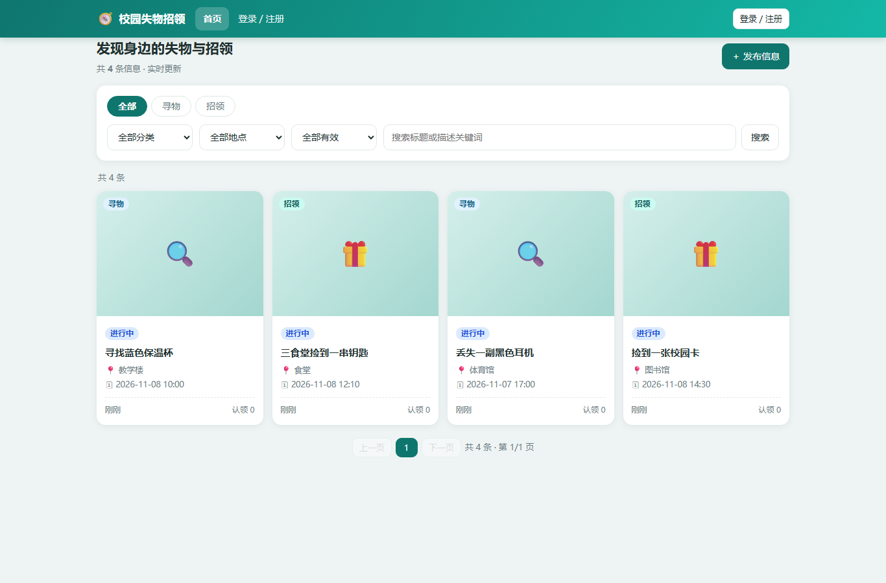
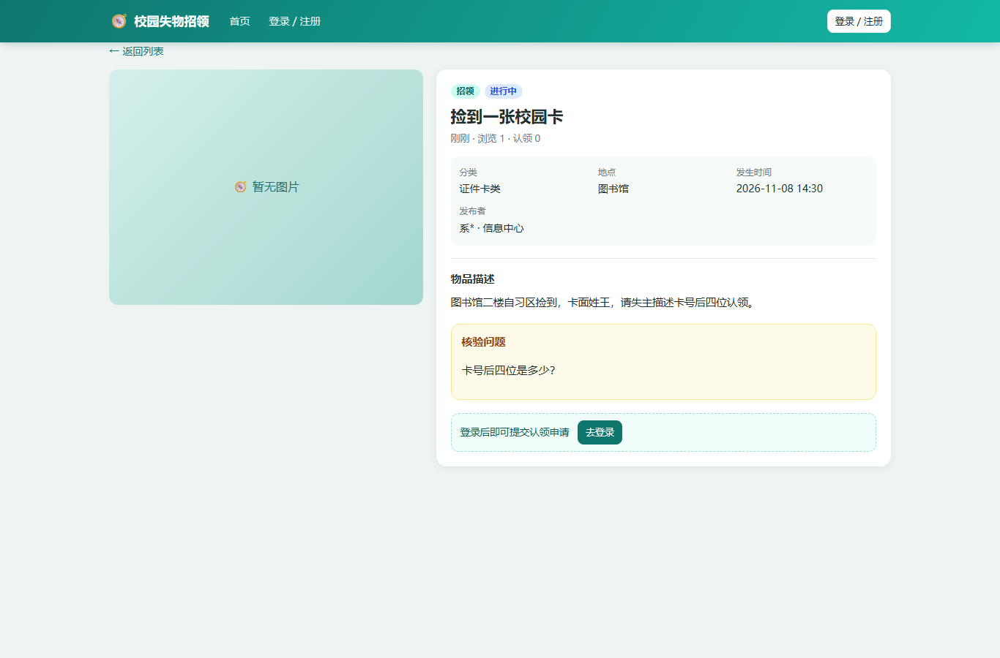

# 校园失物招领系统（C++ / Visual Studio 2022）

一个**零第三方依赖、用 Visual Studio 直接打开即可编译运行**的校园失物招领系统。
后端 C++20（Win32 Winsock HTTP 服务），前端为内嵌在可执行文件中的响应式单页应用（原生 HTML/CSS/JS），
数据落盘为 JSON 文件（数据访问集中在 Store 层，后续可平滑替换为 MySQL），实时通知用 SSE。

> 说明：本工程是"能直接跑起来的完整 MVP"，覆盖失物招领的核心业务闭环与后台管理；
> 与《方案评审与实施计划》中的生产级方案（MySQL / HTTPS / Caddy / PWA）对应关系见文末"后续升级路线"。

---

## 1. 功能清单

### 用户端
- 注册（邀请码）/ 登录 / 注销 / 修改密码；服务端会话 Cookie
- 浏览列表：类型（寻物/招领）、分类、地点、状态筛选，关键词搜索（标题+描述，中文子串），分页
- 发布寻物/招领：标题、描述、分类、地点、发生时间、核验问题、有效期（1~90 天）
- 图片上传（每帖最多 3 张，JPG/PNG/WebP，单张 ≤5MB，Magic Bytes 校验，随机文件名）
- 详情页：图片、状态、发布者（脱敏）、核验问题；发布者可编辑/删除
- 认领闭环：
  1. 失主提交认领申请（回答核验问题 + 留言）
  2. 发布者/管理员审核通过 → 生成 **6 位一次性取件码**（24 小时有效）
  3. 线下交接，发布者输入取件码核销 → 物品完成，双方收到通知
  4. 审核拒绝 / 申请人取消 / 24 小时未审核自动过期 / 取件码过期自动回退
- 我的：我发布的（含认领申请审核）、我认领的（含取件码展示）
- 通知中心：未读红点、全部已读、点击跳转
- 举报违规信息
- 实时：SSE 推送新物品、认领状态、通知与未读数（手机/电脑多端同步）

### 管理后台（admin）
- 统计看板：用户数、物品数、进行中、待审核认领、已完成、待处理举报
- 举报处理（处理/驳回）
- 邀请码管理（创建、用量、有效期）
- 审计日志（登录、发布、删除、审核、下架、邀请码等）
- 物品下架（带原因，通知发布者）

### 业务规则（已实现）
- 状态机：物品 open → claim_pending → claim_approved → completed；另有 expired / removed
- **一物一认领**：同一物品同时只允许一个有效认领（Store 层原子检查 + 物品状态约束）
- 防冒领：核验问题 + 发布者审核 + 一次性取件码 + 双方确认
- 物品 30 天自动过期（后台任务每 30 秒扫描）；认领 24 小时未审核自动过期；取件码 24 小时有效
- 权限：普通用户只能操作自己的帖子/认领；管理员可下架/审核/处理举报；越权返回 403
- 联系方式不公开；姓名/学号脱敏展示

---

## 2. 技术栈与工程结构

- **语言**：C++20，只用 Windows 自带库（ws2_32 / bcrypt / iphlpapi），无 vcpkg、无第三方依赖
- **HTTP**：自研小型 HTTP/1.1 服务（Winsock，线程 per 连接，支持路由参数、multipart、SSE）
- **实时**：Server-Sent Events（/api/stream），浏览器 EventSource 自动重连
- **持久化**：JSON 文件（原子写：db.json.tmp → rename），图片存 data/uploads
- **安全**：PBKDF2-HMAC-SHA256（6 万次迭代 + 随机盐）、服务端会话、CSRF 请求头校验、
  上传 Magic Bytes/大小/路径穿越校验、登录/注册/发帖/上传/举报限流、审计日志
- **前端**：内嵌单页应用（哈希路由、fetch、EventSource、响应式 CSS，无 CDN/外部资源）

~~~
app/
├─ CampusLostFound.sln                 # VS 解决方案，双击打开
├─ CampusLostFound/
│  ├─ CampusLostFound.vcxproj          # Debug/Release | x64，C++20，/utf-8
│  └─ src/
│     ├─ main.cpp                      # 启动、命令行参数、局域网地址打印、Ctrl+C 退出
│     ├─ Api.cpp/.h                    # 全部 REST 路由、视图序列化、SSE 推送中心
│     ├─ Auth.cpp/.h                   # PBKDF2 密码、会话、限流
│     ├─ Store.cpp/.h                  # 领域模型、状态机、JSON 持久化、过期扫描
│     ├─ Http.cpp/.h                   # Winsock HTTP 服务器、路由、multipart、SSE socket
│     ├─ Json.cpp/.h                   # 极简 JSON 解析/序列化
│     ├─ Util.cpp/.h                   # 字符串/时间/随机/Base64/SHA256/脱敏
│     ├─ WebUi.h                       # 内嵌前端页面（8 段 raw string 拼接）
│     └─ SelfTest.cpp/.h               # 进程内自测（41 项）
├─ docs/API_CONTRACT.md                # 前后端接口契约
├─ docs/screenshots/                   # 运行截图
└─ scripts/                            # 启动/构建/冒烟测试/演示数据脚本
~~~

---

## 3. 用 Visual Studio 打开与运行

### 3.1 前置条件
- Windows 10/11 x64
- Visual Studio 2022，安装"**使用 C++ 的桌面开发**"工作负载（MSVC v143 + Windows SDK 10）

### 3.2 打开
1. 双击打开 **app\CampusLostFound.sln**
2. 顶部选择 **Debug** + **x64**（或 Release + x64）
3. 按 **Ctrl+F5**（不调试运行）或 F5
4. 控制台会打印访问地址、管理员账号与数据目录，例如：

~~~
  本机访问:   http://127.0.0.1:8080
  局域网访问: http://192.168.1.100:8080   (手机需与本机同一网络)
  管理员账号: admin / admin123
  邀请码:     CAMPUS-2026
~~~

5. 浏览器打开 http://127.0.0.1:8080

> 默认工作目录是工程目录，数据会写到 **x64\Debug\data**（exe 同级的 data 目录）。
> 想固定数据目录/端口，用命令行参数启动（见 §4）。

### 3.3 命令行编译（可选）
~~~
& 'D:\VS2022IDE\MSBuild\Current\Bin\MSBuild.exe' app\CampusLostFound.sln /p:Configuration=Release /p:Platform=x64 /m
~~~
（路径按你机器上的 VS 安装位置调整；也可用 VS 开发者命令提示符里的 msbuild。）

---

## 4. 运行参数

~~~
CampusLostFound.exe [--port 8080] [--bind 0.0.0.0] [--data <目录>] [--selftest]
~~~

| 参数 | 默认 | 说明 |
|---|---|---|
| --port | 8080 | 监听端口 |
| --bind | 0.0.0.0 | 绑定地址；只用本机可改 127.0.0.1 |
| --data | exe 同级 data | 数据目录（db.json + uploads） |
| --selftest | — | 只跑自测，不启动网络；可配合 --data 指定临时目录 |

---

## 5. 默认账号与数据

| 项 | 值 |
|---|---|
| 管理员 | 学号 **admin** / 密码 **admin123**（登录后请在"我的"中修改密码） |
| 演示邀请码 | **CAMPUS-2026**（500 次，365 天） |
| 数据文件 | data\db.json（JSON 全量快照） |
| 图片目录 | data\uploads\ |

- **重置数据**：停止服务后删除 data 目录，重启即重新初始化。
- 也可以运行 scripts\reset-data.ps1 一键重置（默认删除 app 下 Debug/Release 的 data 目录）。
- 想先灌入演示数据：启动服务后运行 scripts\demo-data.ps1（会创建 4 条示例物品）。

---

## 6. 手机/局域网访问

1. 手机与电脑连接**同一 Wi-Fi**（或同一路由器）；
2. 电脑上用 ipconfig 查看 IPv4 地址，或直接看控制台打印的"局域网访问"；
3. 手机浏览器访问 http://<电脑IP>:8080 ；
4. 首次访问若被防火墙拦截，用**管理员 PowerShell**放行入站端口：

~~~powershell
New-NetFirewallRule -DisplayName "CampusLostFound-8080" -Direction Inbound -Protocol TCP -LocalPort 8080 -Action Allow -Profile Any
~~~

> 注意：校园网/公共 Wi-Fi 常开启 **AP 隔离（客户端隔离）**，此时手机访问不到电脑。
> 解决办法：改用手机热点（电脑连热点）、自带路由器组建独立局域网，或把服务部署到可互通的服务器。
> 另外 HTTP 不是浏览器安全上下文，拍照上传可用（file input），但 PWA 安装/Service Worker/通知/getUserMedia 需要 HTTPS（见升级路线）。

---

## 7. 测试

### 7.1 进程内自测（41 项，覆盖 JSON/密码/业务闭环/过期/通知/持久化）
~~~
CampusLostFound.exe --selftest
~~~
输出 [PASS]/[FAIL] 与汇总，退出码 0 表示全通过。

### 7.2 HTTP 冒烟测试（32 项，需先启动服务）
~~~powershell
# 终端 1：启动服务
.\x64\Debug\CampusLostFound.exe --port 8080 --data .\x64\Debug\data

# 终端 2：跑冒烟测试（PowerShell 7）
pwsh -NoProfile -File scripts\smoke-test.ps1
~~~
覆盖：健康检查、SPA 首页、登录、注册、发布、搜索、认领、重复认领 409、审核、取件码、
错误取件码 409、核销完成、通知、越权 403、管理统计、邀请码、举报、SSE 握手、注销 401。

---

## 8. 接口与安全说明

- 统一响应：成功 ok=true + data；失败 ok=false + error{code,message}
- 鉴权：登录后 Set-Cookie **lf_sid**（HttpOnly + SameSite=Lax）；所有非 GET 请求需带
  请求头 **X-Requested-With: CampusLF**（CSRF 防护）
- 完整接口见 docs/API_CONTRACT.md；SSE 事件：notification / item-created / item-updated /
  claim-created / claim-updated
- 密码：PBKDF2-HMAC-SHA256（60000 迭代 + 16 字节随机盐，常量时间比较）
- 上传：白名单图片类型 + Magic Bytes + ≤5MB + 随机文件名 + 目录不可执行 + 文件名白名单校验（防路径穿越）
- 越权：每个资源都校验发布者/认领人/管理员身份
- 审计：登录、注销、发布、删除、下架、认领审核、邀请码、举报处理均写审计日志
- 限流：登录（IP/账号）、注册、发帖、上传、举报

---

## 9. 从 JSON 文件切换到 MySQL（后续）

数据访问全部集中在 **Store 层**（Store.h 接口 + Store.cpp 实现）：
- Api.cpp / Auth.cpp 不直接读写文件；
- 把 Store.cpp 中 Load/Save、各类查询替换为 MySQL 实现（连接池 + prepared statement），
  Api 层与前端无需改动；
- 届时按《方案评审与实施计划》使用 MySQL 8.4 LTS + libmariadb，
  并增加 schema 迁移脚本（backend/sql）。

## 10. 后续升级路线（对应方案评审文档）

1. **HTTPS**：Caddy 2.11.9 反向代理 + 内部 CA 或真域名 DNS-01（手机端解锁 PWA/相机/通知）
2. **MySQL 8.4 LTS**：替换 JSON 持久化，支持更大数据量与并发
3. **图片压缩与缩略图**：客户端 canvas 压缩 + 服务端缩略图
4. **PWA**：manifest + Service Worker + 离线壳（必须 HTTPS）
5. **Web Push**：可选（iOS 需安装到主屏幕）
6. **Caddy / WinSW 服务化**：开机自启、崩溃自启、7x24 运行（方案文档 §7.4）

## 11. 已知限制（MVP 边界）

1. 数据存 JSON 文件：单机演示/小范围试用足够；数据量很大或需要并发写时请换 MySQL。
2. HTTP 明文：局域网内网演示可用，正式使用建议加 HTTPS（否则 PWA/通知/相机受限）。
3. 会话存内存：重启服务后需要重新登录。
4. 实时用 SSE（服务端→客户端单向）：足够通知/列表刷新；如需双向聊天再上 WebSocket。
5. 图片未做服务端压缩/缩略图；上传前建议客户端先压缩（每张 ≤5MB 限制已生效）。
6. HTTP 服务为教学/演示级实现（线程 per 连接），未做压测调优；内网几十人规模足够。
7. 管理员默认密码 admin123 必须在首次部署后修改。

---

## 12. 常见问题

| 问题 | 处理 |
|---|---|
| 端口被占用 | 换 --port 8090 等；或结束占用进程 |
| 手机打不开 | 检查同一 Wi-Fi、防火墙入站规则、校园网 AP 隔离；可先用另一台电脑测试 |
| 页面空白/旧版本 | Ctrl+F5 强制刷新；确认 exe 与前端版本一致 |
| 数据损坏 | 停止服务，删除 data\db.json（或整个 data 目录）重启；之前可先备份 |
| 中文控制台乱码 | 用 Windows Terminal 运行；程序已设置 UTF-8 代码页 |
| VS 编译报找不到 SDK | 安装 VS 的"使用 C++ 的桌面开发"工作负载 |
